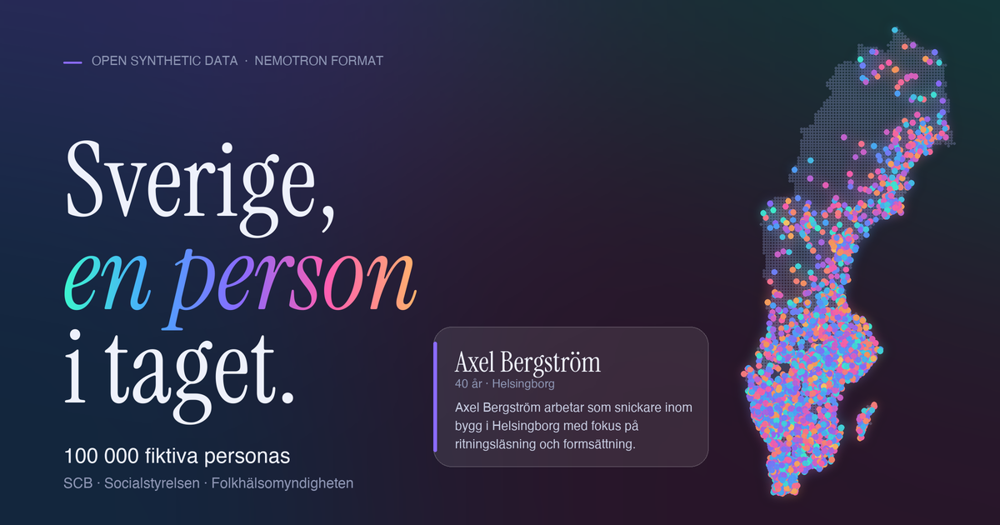

<p align="center">
  <a href="https://birgermoell.github.io/swedish-personas/"></a>
</p>

<h1 align="center">Swedish Personas</h1>

<p align="center"><b>Sverige, en person i taget.</b><br>100,000 fictional Swedish personas in the Nemotron-Personas format, grounded in open statistics.</p>

<p align="center">
[](https://creativecommons.org/licenses/by/4.0/)
[](https://huggingface.co/datasets/birgermoell/swedish-personas)
[](https://docs.nvidia.com/nemo/datadesigner/dev-notes/designing-nemotron-personas)
[](https://huggingface.co/datasets/birgermoell/swedish-personas)
[](https://birgermoell.github.io/swedish-personas/)
</p>

<p align="center">
  <a href="https://birgermoell.github.io/swedish-personas/">Website</a> ·
  <a href="https://huggingface.co/datasets/birgermoell/swedish-personas">Hugging Face</a> ·
  <a href="#quick-start">Quick start</a> ·
  <a href="#fields">Fields</a> ·
  <a href="#method-and-limitations">Method</a>
</p>

---

## At a glance

| | |
|---|---|
| **Personas** | 100,000, fictional, in Swedish |
| **Format** | 23 columns, following [Nemotron-Personas](https://docs.nvidia.com/nemo/datadesigner/dev-notes/designing-nemotron-personas) |
| **Geography** | all 21 counties (`lan`) and 290 municipalities (`kommun`) |
| **Demographics** | sampled from SCB's 2025 joint distribution of county, age, sex and marital status |
| **Health** | `healthcare_persona` from Socialstyrelsen and Folkhälsomyndigheten age and sex rates |
| **Generation** | fixed-seed, rule-based, no LLM, fully reproducible |
| **License** | data CC BY 4.0, code MIT |

## A persona

```json
{
  "uuid": "140ed6c27dd90d271bf3ea34828073ff",
  "professional_persona": "Arvid Ekström arbetar som systemutvecklare inom it och telekom i Luleå med fokus på programmering och systemdesign.",
  "healthcare_persona": "Arvid Ekström lever med högt blodtryck och ringer 1177 för råd innan han kontaktar vården.",
  "persona": "Arvid Ekström är nyfiken och provar gärna nya saker och föredrar små sällskap framför stora fester, med fikakulturen och att ta paus tillsammans som en självklar del av vardagen och släktforskning som en fast punkt i veckan i Luleå.",
  "cultural_background": "Arvid växte upp i Norrbotten. I vardagen märks fikakulturen och att ta paus tillsammans, och det lokala livet i Norrbotten präglas av Jukkasjärvi och Kiruna.",
  "skills_and_expertise_list": "['programmering', 'systemdesign', 'versionshantering', 'kodgranskning']",
  "hobbies_and_interests_list": "['släktforskning', 'svampplockning', 'löpning', 'simning']",
  "career_goals_and_ambitions": "Arvid överväger att byta bransch inom några år.",
  "sex": "Man",
  "age": 38,
  "marital_status": "ogift",
  "household_type": "sambo med hemmavarande barn",
  "education_level": "gymnasieexamen",
  "occupation": "systemutvecklare",
  "kommun": "Luleå",
  "lan": "Norrbotten",
  "country": "Sverige"
}
```

## Quick start

```python
from datasets import load_dataset

ds = load_dataset("birgermoell/swedish-personas", split="train")
print(ds[0]["healthcare_persona"])
```

A companion table, `data/swedish_personas_100k_conditions.parquet`, lists each sampled condition keyed by `uuid`.

This repository does not contain real person records. The prose is template generated, not LLM generated. A synthetic record can coincidentally resemble a real person; do not use it to identify or make decisions about anyone.

## Reproduce

```bash
python3 -m pip install -r requirements.txt
python3 src/fetch_scb.py
python3 src/fetch_health.py
python3 src/generate.py --size 100000 --seed 20251005
python3 src/validate.py
python3 src/make_site_data.py
python3 src/make_map_data.py   # dot map for the website (downloads municipality outlines)
python3 src/make_og_image.py   # social preview image
```

The SCB download step requires internet access. It writes the exact source cells to `data/` with the table URL and retrieval date in `data/source.json`. The generation step writes `data/swedish_personas_100k.parquet` and `data/generation_report.json`. The same source files, Python version and seed produce the same sample. Parquet output may differ byte for byte across Arrow versions.

## Fields

`uuid`, `professional_persona`, `healthcare_persona`, `sports_persona`, `arts_persona`, `travel_persona`, `culinary_persona`, `persona`, `cultural_background`, `skills_and_expertise`, `skills_and_expertise_list`, `hobbies_and_interests`, `hobbies_and_interests_list`, `career_goals_and_ambitions`, `sex`, `age`, `marital_status`, `household_type`, `education_level`, `occupation`, `kommun`, `lan`, `country`.

The columns follow [Nemotron-Personas](https://docs.nvidia.com/nemo/datadesigner/dev-notes/designing-nemotron-personas) (as in Nemotron-Personas-France), with `kommun` (municipality) and `lan` (county) as the Swedish locale fields. As in Nemotron, names and personality scores are not columns, but each persona text names the person. The `*_list` columns are stringified lists. `sex` is SCB's registered binary sex, not gender identity; texts use han/hon accordingly. Ages of 100 and above are `age=100`. `occupation` is `not_in_workforce` for children, students, pensioners and others without an assigned job. `household_type`, `education_level`, `occupation` and all prose are rule-based and **not** calibrated to SCB.

## Health information

`healthcare_persona` (a column in Nemotron's Data Designer persona set, omitted from the public France release) describes health conditions and patient behaviour in one sentence. Conditions are drawn from two open Swedish sources, fetched by `python3 src/fetch_health.py` (see `data/health_source.json`):

- **Socialstyrelsen**, [statistics database, diagnoses in inpatient and/or specialised outpatient care](https://sdb.socialstyrelsen.se/if_dia_sluten_oppen/), 2024: patients per 100,000 by 5-year age band and sex for 44 ICD-10 codes (heart disease, stroke, COPD, cancers, osteoarthritis, dementia, ADHD, autism, Crohn's, psoriasis and others). This measures people seen in specialist care in a year, **not** total prevalence; conditions managed in primary care are under-counted.
- **Folkhälsomyndigheten**, [National Public Health Survey](https://fohm-app.folkhalsomyndigheten.se/Folkhalsodata/pxweb/sv/A_Folkhalsodata/A_Folkhalsodata__B_HLV/), 2024: self-reported shares by age band (16-29, 30-44, 45-64, 65-84, 85+) and sex for people aged 16+ (allergy, asthma, diabetes, high blood pressure, eczema, headache, incontinence, back and musculoskeletal pain, obesity, severe anxiety, doctor-diagnosed depression, severe sleep problems). Under-16s use the Socialstyrelsen rates only.

Each persona's conditions are independent draws from the rate for its age and sex, so there is no comorbidity structure (for example, diabetes does not raise the chance of high blood pressure), and 16-17-year-olds use the 16-29 survey band. The companion file `data/swedish_personas_100k_conditions.parquet` lists the sampled conditions (`uuid`, `source`, `code`, `condition`) and is not part of the Nemotron schema. `validate.py` checks that observed condition counts match the source rates for every condition expected at least 200 times. This is synthetic data for prototyping and language work, not for clinical or epidemiological inference.

## Method and limitations

1. Query [SCB table 000007ME, 2025](https://www.statistikdatabasen.scb.se/pxweb/en/ssd/START__BE__BE0101__BE0101A/BefolkningCKM/) for all counties, non-overlapping ages 0–99 and 100+, registered sex and marital status.
2. Sample 100,000 combinations with probabilities proportional to the returned joint counts. Sample a municipality within its county from municipality total counts.
3. Generate remaining fields with rules in [`src/generate.py`](src/generate.py) using a fixed random seed. No source record or personal data is used.

SCB applies statistical disclosure control to the 2025 table, so source cells may not add exactly to published totals. A random sample has ordinary sampling variation. Municipality is conditionally sampled by county **without** preserving age or marital distributions by municipality. Birthplace, education, employment and occupation are illustrative; do not treat their frequencies or correlations as measured Swedish population facts. The prose is varied but formulaic. These records are suitable for interface prototypes, test data and language experiments, not for population inference, fairness certification or decisions about people.

## Licenses and attribution

The dataset is released under [CC BY 4.0](https://creativecommons.org/licenses/by/4.0/), with attribution to **Statistics Sweden (SCB)** for source statistics and to this project for the synthetic transformations. Health rates: Socialstyrelsen (diagnoses in inpatient and specialised outpatient care, 2024) and Folkhälsomyndigheten (National Public Health Survey, 2024), cited as sources. Population source: Statistics Sweden, *Population by region, marital status, age and sex*, 2025, table 000007ME. The generator and website code are MIT licensed. See [LICENSE-DATA](LICENSE-DATA) and [LICENSE-CODE](LICENSE-CODE).

## Publishing

The site in `docs/` is deployable via the included GitHub Pages workflow. Once GitHub CLI authentication is available, create a public repository and push this directory. Enable GitHub Pages with **GitHub Actions** as the build source. To upload the dataset to the personal Hugging Face account currently authenticated in the environment, run:

```bash
python3 src/publish_hf.py
```

The publishing script refuses to upload until the Parquet release contains exactly 100,000 rows. It never stores a token in the repository.
